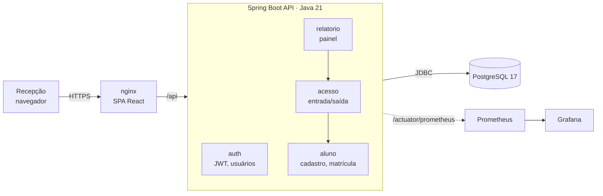
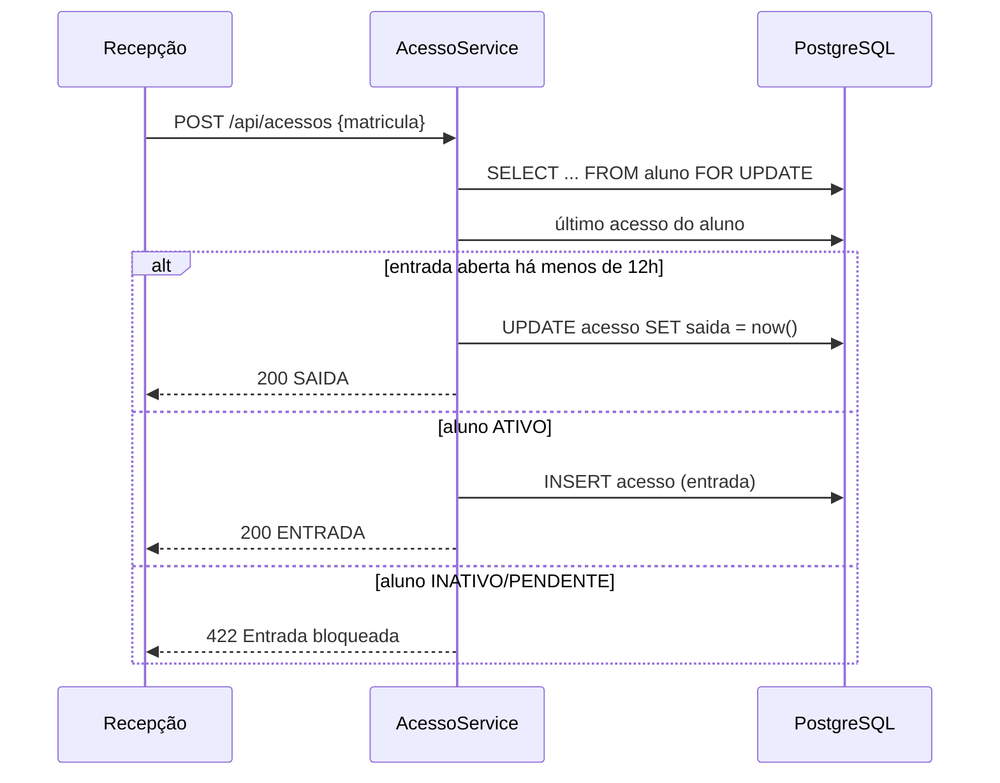

# Academia 2.0

[](https://github.com/johnruanito/gym-ruanito/actions/workflows/ci.yml)
[](https://github.com/johnruanito/gym-ruanito/actions/workflows/security.yml)

Sistema de cadastro de alunos e controle de entrada/saída de academia. É a reescrita do projeto
original em Java EE (JSF + EJB + JPA/MySQL + WildFly) para uma stack atual, com API REST e SPA.

| Camada | Antes | Agora |
|---|---|---|
| Linguagem | Java 8/11 | **Java 21** (records, virtual threads) |
| Backend | EJB `@Stateless` + JSF Managed Beans, WildFly | **Spring Boot 4.1** (Spring Framework 7), Tomcat embutido |
| API | — (telas JSF acopladas ao servidor) | **REST + OpenAPI** (`/swagger-ui.html`), erros RFC 9457 |
| Persistência | JPA com `drop-and-create`, MySQL | **Spring Data JPA / Hibernate 7**, **PostgreSQL 17**, migrações **Flyway** |
| Segurança | Login fictício (não autenticava) | **Spring Security + JWT** stateless, BCrypt, papéis ADMIN/RECEPCAO |
| Frontend | XHTML/JSF + CSS | **React 19 + TypeScript + Vite + Tailwind 4**, TanStack Query, React Hook Form + Zod |
| Build/Deploy | Ant/NetBeans, `.war` versionado no git | Maven, Docker multi-stage, Docker Compose, **GitHub Actions** |
| Testes | nenhum | JUnit 5 + **Testcontainers** (PostgreSQL real), Vitest, **Playwright** (E2E), cobertura JaCoCo |
| Observabilidade | — | Actuator, **Prometheus + Grafana** com dashboard provisionado, métricas de negócio, logs JSON (ECS) |
| Segurança no CI | — | **CodeQL** (SAST), **Trivy** (dependências, segredos, Dockerfiles e imagens), Dependabot |

## Arquitetura

Monólito modular organizado **por funcionalidade**, não por camada técnica. Para o porte do domínio é a
opção mais simples de operar, e cada módulo pode virar serviço próprio se um dia for preciso.
As decisões e seus trade-offs estão registradas em [`docs/adr`](docs/adr/README.md).



Registro na catraca: uma única chamada decide entrada ou saída, com lock na linha do aluno para
evitar registro duplo.



```
backend/src/main/java/br/com/academia/
├── aluno/      Aluno (entidade), Cpf, Matricula, MatriculaGenerator, AlunoService, web/ (controller + DTOs)
├── acesso/     Acesso (regras de entrada/saída), AcessoService, web/
├── estado/     UFs (tabela de referência)
├── relatorio/  Painel com indicadores
├── auth/       Usuário, login JWT, SecurityConfig, criação do admin inicial
└── shared/     Configuração, tratamento global de erros, paginação
frontend/src/
├── api/        cliente HTTP tipado + hooks TanStack Query
├── auth/       sessão e proteção de rotas
├── components/ layout e componentes de UI
└── pages/      Painel, Controle de acesso, Alunos, Cadastro, Entradas e saídas
```

As regras de negócio ficam no domínio (`Acesso.abandonado()`, `Situacao.permiteEntrada()`, `Cpf.isValido()`),
não nos controllers. As entidades não expõem setters genéricos: a alteração passa por `Aluno.atualizar(DadosAluno)`.

## Como rodar

### Tudo em containers

```bash
cp .env.example .env              # defina DB_PASSWORD, JWT_SECRET (openssl rand -base64 48) e ACADEMIA_ADMIN_PASSWORD
docker compose up -d --build
# http://localhost:8081  → entre com ACADEMIA_ADMIN_USERNAME / ACADEMIA_ADMIN_PASSWORD
```

### Desenvolvimento

```bash
# 1. banco
docker run -d --name academia-db -p 5432:5432 \
  -e POSTGRES_DB=academia -e POSTGRES_USER=academia -e POSTGRES_PASSWORD=academia postgres:17-alpine

# 2. API (porta 8080). O admin é criado no primeiro start.
cd backend
export JWT_SECRET=$(openssl rand -base64 48)   # obrigatório: não há valor padrão
ACADEMIA_ADMIN_USERNAME=admin ACADEMIA_ADMIN_PASSWORD=admin12345 mvn spring-boot:run
# Swagger: http://localhost:8080/swagger-ui.html

# 3. Frontend (porta 5173, com proxy de /api para 8080)
cd frontend && npm install && npm run dev
```

### Testes

```bash
cd backend && mvn verify          # unitários + integração (Docker p/ Testcontainers) + cobertura em target/site/jacoco
cd frontend && npm test           # Vitest
cd frontend && npm run test:e2e   # Playwright (sobe o build com vite preview; API simulada)
```

| Suíte | Casos |
|---|---|
| Backend unitário | CPF (incluindo valores acima do limite do `int`), formato de matrícula, entrada/saída/abandono, regra de situação |
| Backend integração | login/401, cadastro, CPF duplicado (409), busca por nome, entrada→saída por matrícula e RG, presentes, exclusão bloqueada, inativo bloqueado (422), edição concorrente (409), erros por campo (400) |
| Frontend E2E | redirecionamento ao login e retorno à página pedida, senha errada, validação de CPF no cliente, erro do servidor no campo certo, catraca (entrada/saída e foco), bloqueio de inativo, filtros persistidos na URL |

### Observabilidade

```bash
docker compose --profile observability up -d
# Grafana: http://localhost:3000 (admin / GRAFANA_PASSWORD) → pasta "Academia" → "Academia API"
# Prometheus: http://localhost:9090
```

O dashboard provisionado mostra taxa de requisições e latência p95 por rota, taxa de erro 5xx, heap da
JVM, pool de conexões e a métrica de negócio `academia_acessos_total{resultado=ENTRADA|SAIDA|BLOQUEADA}`.
No perfil `prod` os logs saem em JSON (Elastic Common Schema), prontos para Loki ou ELK.

### Segurança no CI

- **CodeQL** (`security-extended`) em Java e TypeScript, resultados na aba *Security* do GitHub.
- **Trivy** nas dependências (Maven e npm), em segredos commitados, em má configuração de Dockerfile/Compose e nas imagens finais. Falha o build com CVE HIGH/CRITICAL que tenha correção disponível.
- Execução semanal agendada, porque CVEs novas surgem sem mudança no código.
- **Dependabot** para Maven, npm, Actions e imagens base.

## API

| Método | Rota | Descrição |
|---|---|---|
| POST | `/api/auth/login` | Autentica e grava a sessão em cookies `HttpOnly` (o corpo não tem token) |
| POST | `/api/auth/refresh` | Troca o refresh token (cookie) por um novo par, com rotação |
| POST | `/api/auth/logout` | Revoga a sessão no servidor e apaga os cookies |
| GET | `/api/auth/me` | Perfil de quem está logado |
| GET | `/api/alunos?nome=&matricula=&rg=&cpf=&celular=&situacao=&page=&size=` | Pesquisa paginada (também substitui o antigo "relatório de situações") |
| GET | `/api/alunos/{matricula}` | Detalhe |
| POST | `/api/alunos` | Cadastro: matrícula gerada no servidor |
| PUT | `/api/alunos/{matricula}` | Edição com controle de concorrência (`versao`) |
| DELETE | `/api/alunos/{matricula}` | Exclusão de aluno sem histórico (ADMIN) |
| POST | `/api/acessos` | `{matricula}` ou `{rg}`: alterna entrada/saída |
| GET | `/api/acessos?matricula=&de=&ate=` | Relatório de entradas e saídas (padrão: últimos 30 dias) |
| GET | `/api/acessos/presentes` | Quem está na academia agora |
| GET | `/api/painel` | Totais por situação, presentes e entradas do dia |
| GET/POST | `/api/usuarios` | Equipe da academia: listar e cadastrar (ADMIN) |
| PUT | `/api/usuarios/{id}` | Alterar nome e papel (ADMIN) |
| POST | `/api/usuarios/{id}/desativar` · `/reativar` · `/redefinir-senha` | Bloquear/liberar login e definir senha provisória (ADMIN) |
| PUT | `/api/conta/senha` | Trocar a própria senha, confirmando a atual (todos) |

### Papéis

| Papel | Alunos | Catraca | Relatórios | Equipe |
|---|---|---|---|---|
| ADMIN (dono) | consulta, cadastra, edita, exclui | ✓ | ✓ | ✓ |
| RECEPCAO | consulta, cadastra, edita | ✓ | ✓ | — |
| INSTRUTOR | consulta | — | ✓ | — |
| GET | `/api/estados` | UFs |

## Defeitos do sistema antigo corrigidos

| # | Problema no código original | Correção |
|---|---|---|
| 1 | CPF como `Integer`: 11 dígitos estouram o int, então CPFs acima de 2.147.483.647 falhavam | CPF em texto normalizado + validação dos dígitos verificadores (backend e frontend) |
| 2 | CEP, RG e telefone como `Integer`: perdiam zeros à esquerda (CEP 01310-100) | Texto com `CHECK` de formato no banco |
| 3 | Matrícula por `SELECT MAX()+1`: dois cadastros simultâneos geravam a mesma chave primária | Contador atômico por ano (`INSERT … ON CONFLICT … RETURNING`) |
| 4 | `persistence.xml` com `drop-and-create`: o banco era apagado a cada deploy | Flyway com migrações versionadas; Hibernate só valida (`ddl-auto: validate`) |
| 5 | Credenciais do banco no código, `transaction-type` inválido, provider Hibernate com libs EclipseLink | Configuração externa por variáveis de ambiente; `JWT_SECRET` obrigatório, sem valor padrão |
| 6 | `Estado` com `@GeneratedValue` numa chave `String` | Sigla como chave natural, tabela carregada por migração |
| 7 | Tela de login sem nenhuma autenticação real | JWT + BCrypt + papéis; admin inicial vindo de variável de ambiente |
| 8 | Controle de acesso deixava entrar aluno INATIVO/PENDENTE | Entrada só para ATIVO (a saída continua sempre permitida) |
| 9 | Entrada sem saída ficava aberta para sempre: o próximo registro, dias depois, virava "saída" | Após `permanencia-maxima` (12h, configurável) a entrada é considerada abandonada e uma nova é aberta |
| 10 | Relatório filtrava a data final pela **saída**, então quem ainda estava na academia não aparecia | Filtro sempre pela data de entrada; entradas abertas aparecem como "sem saída" |
| 11 | Excluir aluno com histórico de acessos estourava erro de FK na tela | 409 com orientação para inativar; FK `RESTRICT` |
| 12 | Duas recepcionistas editando o mesmo aluno: a última sobrescrevia a outra sem aviso | Lock otimista (`@Version`), com 409 ao salvar uma versão desatualizada |
| 13 | Enums gravados por ordinal: reordenar o enum corrompia os dados | `EnumType.STRING` + `CHECK` no banco |
| 14 | Pesquisa por JPQL concatenada (`... AND 1 = 1`), sensível a maiúsculas e sem paginação | Criteria API tipada, busca sem distinção de maiúsculas com índice trigram, paginação |
| 15 | Duplo registro simultâneo na catraca podia criar duas entradas | Lock pessimista na linha do aluno durante o registro |

## Configuração

| Variável | Padrão | Descrição |
|---|---|---|
| `DB_URL` / `DB_USERNAME` / `DB_PASSWORD` | `localhost:5432/academia` | Conexão PostgreSQL |
| `JWT_SECRET` | — | Chave HMAC aleatória, mínimo 32 bytes. **Obrigatória em todos os ambientes**: quem a conhece emite token de qualquer academia |
| `JWT_TTL` | `15m` | Validade do access token (renovado automaticamente pelo refresh) |
| `ACADEMIA_SESSAO_DURACAO` | `12h` | Duração máxima da sessão desde o login; renovar não estende |
| `ACADEMIA_COOKIE_SEGURO` | `true` | Cookies só em HTTPS. `false` apenas para teste por IP sem TLS |
| `ACADEMIA_ADMIN_USERNAME` / `_PASSWORD` | — | Admin criado no primeiro start, se a tabela de usuários estiver vazia |
| `ACADEMIA_ZONE` | `America/Belem` | Fuso usado para "hoje" e para os períodos dos relatórios |
| `ACADEMIA_PERMANENCIA_MAXIMA` | `12h` | Tempo após o qual uma entrada sem saída é considerada abandonada |

## Roadmap

**Segurança e LGPD** (ver [ADR 0003](docs/adr/0003-jwt-stateless.md))
- [x] Sessão em cookie `HttpOnly` + refresh token rotativo com revogação no logout ([ADR 0006](docs/adr/0006-sessao-cookies-refresh-rotativo.md))
- [ ] Rate limiting no login (Bucket4j)
- [ ] Auditoria de alterações em dados pessoais (Hibernate Envers: quem, quando, o quê)
- [ ] CPF mascarado nas respostas para o papel RECEPCAO; consentimento LGPD no cadastro
- [x] Gestão de usuários (CRUD, troca de senha, desativação)

**Qualidade**
- [ ] Testes de arquitetura das fronteiras entre módulos (Spring Modulith)
- [ ] Tipos do frontend gerados a partir do OpenAPI (elimina divergência do mock E2E)
- [ ] Tracing distribuído (OpenTelemetry → Tempo)

**Negócio**
- [ ] Planos e mensalidades, com situação PENDENTE automática por inadimplência
- [ ] Check-in por QR code / integração com catraca física
